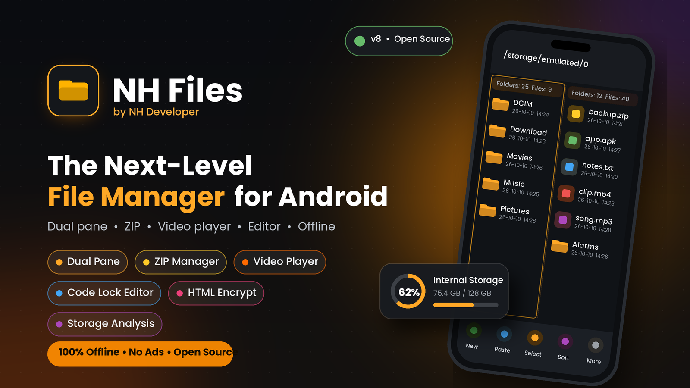

<div align="center">



# NH Files

**The next-level, MT Manager–inspired file manager for Android — 100% offline, no ads, no account.**

[](LICENSE)
[](https://github.com/NH-Developer/nh-files/actions/workflows/android-ci.yml)


</div>

> Replace `NH-Developer/nh-files` above with your actual GitHub `owner/repo` once you push this project, so the CI badge links to your own Actions runs.

## Contents
- [Features](#features)
- [Tech stack](#tech-stack)
- [Getting started](#getting-started)
- [Building a signed release APK](#building-a-signed-release-apk)
- [Permissions](#permissions)
- [Project structure](#project-structure)
- [Known limitations](#known-limitations-by-design--android)
- [Contributing](#contributing)
- [License](#license)
- [Version history](#version-history)

## Features

**File browsing & operations**
Breadcrumb navigation · list/grid view · sort & type filters · hidden files · pull-to-refresh · dual-pane (always left/right, phones included) · multi-select · copy/cut/paste with replace-skip-keep-both conflict handling · create/rename/delete with confirmation · progress with cancel · search · recent files · bookmarks · scroll-to-zoom list animation.

**ZIP manager**
Browse archive contents as virtual folders · extract all or selected entries · create new archives · add copied files · rename/delete entries · test archive integrity · ZIP-slip protected.

**APK inspector**
Package name, version, min/target SDK, signing certificate (SHA-256), requested permissions, raw entry list · install via the system installer.

**Code editor**
Line numbers · syntax colors for 40+ languages/formats · find & replace · undo/redo · encoding detection and manual choice · safe atomic save (never corrupts the original on a failed write) · Save As · **"Edit text only" lock** — for recognized code/markup files, only the text inside quotes (shown in green) is editable by default, so the file's structure can't be broken by accident; a lock icon lets you unlock full editing.

**HTML encryption**
Turn any `.html`/`.htm` file into a self-decrypting copy: the real markup is XOR-ciphered with a random per-file key and Base64-encoded inside a small bootstrap script, so the output file still opens and runs normally in a browser/WebView, while its raw source is scrambled rather than plain Base64 (which a browser can't execute directly). Decrypt reverses it. The original file is never modified.

**Built-in video player**
Merged from *Video Player Offline* — gesture controls, subtitles (incl. auto-loaded `.srt`/`.vtt` next to the video), extra audio codecs via an FFmpeg decoder, playback speed, picture-in-picture, background playback, resume, and a full library (Videos/Folders/Playlists/Settings).

**Audio player**
Keeps playing in the background after you leave the screen, with next/previous across every audio file in the folder and a "Stop playback" control.

**Storage analysis**
Usage by file category, the 100 largest files, and a SHA-256 duplicate finder — nothing is ever deleted without reviewing and confirming first.

**Viewers**
Image (pinch/double-tap zoom), video, audio, PDF (page-by-page rendering).

**Settings**
Light/dark/system theme, default start folder, extensions/hidden-files visibility, default sort, confirmation toggles, recent-history controls.

## Tech stack
- **Language:** Kotlin
- **UI:** Jetpack Compose, Material 3 (plus a small View/XML surface for the merged video player)
- **Architecture:** MVVM, single `MainViewModel` + a dedicated `EditorViewModel`
- **Persistence:** DataStore (settings), Room (video player library)
- **Media:** Media3 (ExoPlayer, Session) for both video and background audio
- **Async:** Kotlin Coroutines & Flow throughout — no blocking I/O on the main thread
- **Build:** Gradle 8.14.3 (wrapper included), AGP 8.7.3, compile/target SDK 35, minSdk 26

## Getting started
```bash
git clone https://github.com/<you>/nh-files.git
cd nh-files
./gradlew assembleDebug
```
Or just open the folder in Android Studio (or Code on the Go) and let Gradle sync — the wrapper downloads everything it needs on first sync (internet required once).

Run the tests before you rely on a build:
```bash
./gradlew testDebugUnitTest        # file operations + ZIP manager (incl. ZIP-slip, conflicts, corrupt archives)
./gradlew connectedDebugAndroidTest
```

## Building a signed release APK
This copy of the project already includes a ready-to-use keystore (`app/nhfiles-release.keystore`) and `app/keystore.properties`, so you can build a signed release immediately:
```bash
./gradlew assembleRelease
```
The signed APK lands in `app/build/outputs/apk/release/`.

**Save these somewhere safe outside this project** (password manager, private note) — if you lose them, you can never publish an update to an app people already installed from this signing key:

| | |
|---|---|
| Keystore file | `app/nhfiles-release.keystore` |
| Key alias | `nhfiles` |
| Store password | `BfyGEU1yGprtNXdGtUsC` |
| Key password | `BfyGEU1yGprtNXdGtUsC` (same as store password — required by the PKCS12 format) |
| Expiry | 9,125 days (25 years) from generation — until 2051 |

`app/keystore.properties` and `*.keystore`/`*.jks` are already in `.gitignore`, so pushing this project to GitHub will **not** upload either file — but they're real secrets sitting on your device right now, so treat them that way: back them up privately, don't paste them in a public issue or screen-share, and generate a fresh keystore instead of reusing this one for anything you didn't ask me to sign.

### Generating your own instead
If you'd rather use your own alias/passwords, delete `app/nhfiles-release.keystore` and `app/keystore.properties`, then:
```bash
keytool -genkeypair -v -keystore app/nhfiles-release.keystore -alias <your-alias> \
  -keyalg RSA -keysize 2048 -validity 9125 -storetype PKCS12
```
`-validity` is in days (`9125` ≈ 25 years, what Google Play requires for new apps) — change it for a different expiry. Copy `app/keystore.properties.example` to `app/keystore.properties` and fill in your alias and password (PKCS12 requires `keyPassword` to equal `storePassword`, which `keytool` enforces either way).

Without `app/keystore.properties` present, `assembleRelease` still runs but produces an **unsigned** APK (useful for CI); `assembleDebug` is unaffected either way.

## Permissions
- **Android 11+:** "All files access" (`MANAGE_EXTERNAL_STORAGE`), requested on first launch with an explanation — required for a file manager to use real file paths. Google Play only allows this permission for file-manager apps; for Play distribution you must submit the permission declaration form.
- **Android 8–10:** the classic read/write storage permission.
- `REQUEST_INSTALL_PACKAGES`: only to hand an APK to the system installer.
- Revoked access is detected when the app resumes, and the permission screen is shown again.

## Project structure
```
app/src/main/java/com/nhdeveloper/nhfiles/
├── data/        # Repositories: file ops, ZIP, APK reader, text IO, storage scanner, settings, HTML crypto
├── audio/       # Background audio player (ExoPlayer + MediaSessionService)
├── ui/          # MainViewModel, EditorViewModel, Compose screens, theme
└── vpo/         # Merged "Video Player Offline" app (its own data/player/ui layers)
app/src/test/          # Unit tests (file operations, ZIP manager)
app/src/androidTest/   # Instrumentation tests
docs/                  # README assets (banner.png)
.github/workflows/     # CI
```

## Known limitations (by design / Android)
- `Android/data` and `Android/obb` are blocked by Android 11+ even with All-files access, so they may not be listable — no workaround is attempted.
- Archives: ZIP/JAR only open inside the app; RAR/7z/TAR are listed but opened with another app. Password-protected ZIPs aren't supported.
- APK tools are inspection + install only — no manifest decoding, resource/DEX editing, or re-signing.
- Symbolic links are never followed or copied. Cancelling a copy keeps whatever was already copied.
- Files over 2 MB open in the editor as a read-only 1 MB preview; syntax colors are disabled above 100 KB.
- Duplicate scan considers files of 32 KB or more. Animated GIFs are shown as a static frame; EXIF mirror flags are ignored.
- No root features.
- "Add files" to a ZIP uses the in-app clipboard: copy files in the browser first, then use "Add copied files here".
- `org.jellyfin.media3:media3-ffmpeg-decoder` (extra audio codecs in the video player) is **GPL-3.0**, not MIT — see [License](#license).

## Contributing
Bug reports and focused PRs are welcome — see [CONTRIBUTING.md](CONTRIBUTING.md) for setup and guidelines.

## License
This project is licensed under the [MIT License](LICENSE).

One bundled dependency is **not** MIT: `org.jellyfin.media3:media3-ffmpeg-decoder` (extra audio codecs — AC-3/E-AC-3/DTS — for the built-in video player) is GPL-3.0. A build that includes it must, as a whole, be distributed under GPL-3.0-compatible terms. To keep a build strictly MIT, remove that dependency line from `app/build.gradle.kts` and the matching renderer setup in `app/src/main/java/com/nhdeveloper/nhfiles/vpo/player/PlayerHolder.kt` — the player still works for all standard formats without it.

## Version history
<details>
<summary>v1 – v8 changelog</summary>

- **v9.0.2** — Hotfix: the signing config crashed the build (`keystoreProps.getProperty("storeFile") must not be null`) whenever `app/keystore.properties` existed but was missing or had blank values for any of the four required keys (e.g. an incomplete file committed by mistake). It now checks every key individually and also confirms the keystore file itself exists, falling back to an **unsigned** release with a clear warning instead of failing the whole build — only a fully-correct `keystore.properties` enables signing now.


</details>
